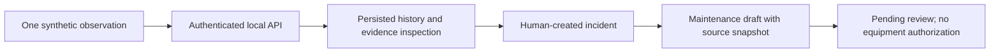

# EDGEOPS — Software evidence and hardware-validation preparation

Evidence reviewed: **24 November 2026**. [Project repository](https://github.com/shah-hussain-bangash/AI-Edge-Semiconductor-Career-Projects.) · [Draft implementation PR #2](https://github.com/shah-hussain-bangash/AI-Edge-Semiconductor-Career-Projects./pull/2)

## Project at a glance

EDGEOPS is an engineering portfolio project for industrial condition monitoring and human-reviewed maintenance. The implemented scope is a local software prototype with authenticated APIs, a dashboard, synthetic observations, offline experiment records and governed review workflows. ESP32 firmware and an offline serial-capture handoff prepare for later physical validation.

**Current status: software demonstrated with synthetic inputs; physical validation pending.** The owner reports that some ordered hardware has arrived. The full set is not yet confirmed, and connection is deferred until the hardware is complete. No received-part photos, exact variants, connection, calibration or physical acceptance were verified for this evidence page. The original 30-product selection is preserved.

The implementation cited here is on **`ui/production-workspace-20261119`**, in draft PR #2 targeting **`dashboard-live-edit`**. It is not merged to the default branch. Links below pin the reviewed commit, **`9f8831f257c490a0b8febf701628bae2ecc63c2d`**, so readers can distinguish the demonstrated software from older default-branch documentation.

## Engineering contribution

I implemented software that carries a synthetic observation's readings, units, quality and clock limitations into an incident and a maintenance draft. The saved source snapshot lets a reviewer see the evidence used to prepare the draft. The workflow does not infer an equipment fault or authorize physical action.

This work emphasizes traceability: valid zeros remain zeros, unavailable readings remain null, an unverified observation clock stays unverified, and a receipt is distinguished from proof of physical acquisition. I also prepared a measurable first hardware-acceptance milestone without treating software tests as evidence of equipment performance.

## Demonstrated software path

The recorded walkthrough ran through in-process API requests against a disposable database. It did not connect to a serial port, running user dashboard or physical equipment. The walkthrough itself is not a browser test; separate CI browser acceptance evidence is linked below.

## Evidence register

| ID | Claim supported | Evidence and limit |
| --- | --- | --- |
| EVID-001 | One synthetic observation can be inspected and carried into an incident and maintenance draft. | [Sanitized JSON result](https://github.com/shah-hussain-bangash/AI-Edge-Semiconductor-Career-Projects./blob/9f8831f257c490a0b8febf701628bae2ecc63c2d/projects/industrial-edge-ai-predictive-maintenance/phase-01-hardware/validation/synthetic-operations-result.json), [replay script](https://github.com/shah-hussain-bangash/AI-Edge-Semiconductor-Career-Projects./blob/9f8831f257c490a0b8febf701628bae2ecc63c2d/projects/industrial-edge-ai-predictive-maintenance/phase-01-hardware/validation/run_synthetic_operations.py) and [run notes](https://github.com/shah-hussain-bangash/AI-Edge-Semiconductor-Career-Projects./blob/9f8831f257c490a0b8febf701628bae2ecc63c2d/projects/industrial-edge-ai-predictive-maintenance/phase-01-hardware/validation/README.md). Confirms software behavior only. |
| EVID-002 | Source content, units, quality and clock limitations are retained. | [Observation-to-incident tests](https://github.com/shah-hussain-bangash/AI-Edge-Semiconductor-Career-Projects./blob/9f8831f257c490a0b8febf701628bae2ecc63c2d/projects/industrial-edge-ai-predictive-maintenance/dashboard/tests/test_observation_incidents.py) and [history-query tests](https://github.com/shah-hussain-bangash/AI-Edge-Semiconductor-Career-Projects./blob/9f8831f257c490a0b8febf701628bae2ecc63c2d/projects/industrial-edge-ai-predictive-maintenance/dashboard/tests/test_observation_queries.py). The sample deliberately contains synthetic zero acceleration and missing temperature/current/voltage. |
| EVID-003 | The inspected implementation passed automated software checks. | Four successful workflow families at the pinned commit, linked below. A passing check is not proof of deployment or physical performance. |
| EVID-004 | The first physical milestone has explicit acceptance criteria. | [H1 sensor-only checklist](https://github.com/shah-hussain-bangash/AI-Edge-Semiconductor-Career-Projects./blob/9f8831f257c490a0b8febf701628bae2ecc63c2d/projects/industrial-edge-ai-predictive-maintenance/phase-01-hardware/validation/FIRST-HARDWARE-ACCEPTANCE.md). All physical checks remain pending; proposed targets require agreement before execution. |
| EVID-005 | Preparation retains the original hardware scope. | [30-product matrix](https://github.com/shah-hussain-bangash/AI-Edge-Semiconductor-Career-Projects./blob/9f8831f257c490a0b8febf701628bae2ecc63c2d/projects/industrial-edge-ai-predictive-maintenance/phase-01-hardware/docs/physical-connection-pack/all-30-connection-matrix.csv) and [connection preparation pack](https://github.com/shah-hussain-bangash/AI-Edge-Semiconductor-Career-Projects./blob/9f8831f257c490a0b8febf701628bae2ecc63c2d/projects/industrial-edge-ai-predictive-maintenance/phase-01-hardware/docs/physical-connection-pack/README.md). Component families are not confirmation of received board pinouts or ratings. |

Saved synthetic result SHA-256: `1a06a3ae2c4035fed2175267f4b71f37e48ea8a890c1d1c880392d6b72fe1922` (UTF-8 file bytes with LF newlines). The result contains no credentials, cookies, user identifiers or live measurements. A hash establishes content identity, not physical authenticity.

## Verification outcomes

The [recorded local verification](https://github.com/shah-hussain-bangash/AI-Edge-Semiconductor-Career-Projects./blob/9f8831f257c490a0b8febf701628bae2ecc63c2d/projects/industrial-edge-ai-predictive-maintenance/phase-01-hardware/validation/README.md) reports **31/31 targeted regression tests passed**: observation-to-incident 10, history queries 5, acquisition registry 7 and incident-to-planning 9. The isolated walkthrough additionally checked that exactly one observation existed and the persisted maintenance record remained `draft`.

| Automated workflow | Observed outcome at the pinned commit |
| --- | --- |
| [Dashboard checks](https://github.com/shah-hussain-bangash/AI-Edge-Semiconductor-Career-Projects./actions/runs/45332066838) | Success |
| [UI browser acceptance](https://github.com/shah-hussain-bangash/AI-Edge-Semiconductor-Career-Projects./actions/runs/45332067040) | Success |
| [Offline experiment registry](https://github.com/shah-hussain-bangash/AI-Edge-Semiconductor-Career-Projects./actions/runs/45332066983) | Success |
| [Offline scikit-learn comparison](https://github.com/shah-hussain-bangash/AI-Edge-Semiconductor-Career-Projects./actions/runs/45332066993) | Success |

[Machine-readable CI snapshot](ci-evidence.json) records the inspected commit and public run links. These are historical outcomes for that commit, not a live status badge or a claim about later revisions.

## First physical milestone

H1 calls for a **600-second stationary sensor-only baseline**, with the motor disconnected, plus reference comparisons for:

- **P03 ADXL345:** three acceleration axes and static orientation checks. Existing 1 Hz summaries do not establish vibration-spectrum or fault-detection performance.
- **P04 DS18B20:** temperature readings compared with a suitable reference.
- **P05 INA219:** current offset and scale checks, with any nonzero-current procedure behind separate qualified review and authorization.

The [full checklist](https://github.com/shah-hussain-bangash/AI-Edge-Semiconductor-Career-Projects./blob/9f8831f257c490a0b8febf701628bae2ecc63c2d/projects/industrial-edge-ai-predictive-maintenance/phase-01-hardware/validation/FIRST-HARDWARE-ACCEPTANCE.md) specifies proposed numerical thresholds, sample metadata, valid/invalid counts, raw captures, hashes, quality mapping and independent evidence review. None has a physical PASS result. Required dependencies include the complete received set, exact module identification, a ready bench, adequate reference capability and qualified review.

## What this evidence does not establish

Real sensor operation, calibrated measurement accuracy, secure measured edge-to-cloud transport, Raspberry Pi inference performance, predictive-maintenance effectiveness and industrial deployment remain unverified. The existing measured handoff is offline; the dashboard ingestion path remains synthetic-only. The target MQTT, ONNX and PostgreSQL/TimescaleDB architecture should be read as planned scope unless backed by separate measured evidence.

No real-world failure prediction, uptime improvement, cost saving, safety certification or production-ready system is claimed. The repository's other six project concepts remain future scope.

## Reproduce or review

Start with the [pinned walkthrough instructions](https://github.com/shah-hussain-bangash/AI-Edge-Semiconductor-Career-Projects./blob/9f8831f257c490a0b8febf701628bae2ecc63c2d/projects/industrial-edge-ai-predictive-maintenance/phase-01-hardware/validation/README.md) and use an interpreter with the existing dashboard test dependencies. The replay creates disposable test data and writes to a new output path; it does not require hardware. Inspect the corresponding source/tests and GitHub run logs rather than relying on screenshots or this summary alone.
