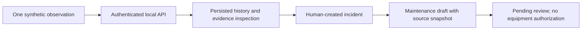

# EDGEOPS — Software evidence and hardware-validation preparation

Evidence reviewed: **24 November 2026**. [Project repository](https://github.com/shah-hussain-bangash/AI-Edge-Semiconductor-Career-Projects.) · [Draft implementation PR #2](https://github.com/shah-hussain-bangash/AI-Edge-Semiconductor-Career-Projects./pull/2)

## Project at a glance

EDGEOPS is an engineering portfolio project for industrial condition monitoring and human-reviewed maintenance. The implemented scope is a local software prototype with authenticated APIs, a dashboard, synthetic observations, offline experiment records and governed review workflows. ESP32 firmware and an offline serial-capture handoff prepare for later physical validation.

**Current status: software demonstrated with synthetic inputs; physical validation pending.** The owner reports that some ordered hardware has arrived. The full set is not yet confirmed, and connection is deferred until the hardware is complete. No received-part photos, exact variants, connection, calibration or physical acceptance were verified for this evidence page. The original 30-product selection is preserved.

The implementation is on **`ui/production-workspace-20261119`**, in draft PR #2 targeting **`dashboard-live-edit`**. It is not merged to the default branch. The original walkthrough, screenshot and PDF evidence retains its recorded source revision, **`9f8831f257c490a0b8febf701628bae2ecc63c2d`**. Subsequent verified work is listed separately below, with the latest reviewed implementation pinned to **`99e989aff13e78d2b145f159d350f079bdf85371`**.

## Subsequent verified software work

The latest implementation reviewed for this update is **`99e989aff13e78d2b145f159d350f079bdf85371`**, still in draft PR #2. Its four application CI workflow families passed. Earlier records below retain their original execution provenance; later work is pinned separately.

| Work | Verified result | Evidence and boundary |
| --- | --- | --- |
| Fresh installation | Dashboard and optional ML dependencies installed in a separate Windows Python 3.14.8 environment; dependency consistency passed; **34 targeted tests passed** and the synthetic operations replay completed. | [Installation record and package/archive versions](https://github.com/shah-hussain-bangash/AI-Edge-Semiconductor-Career-Projects./blob/27d8296e0d15997d61b9bb8fd9bc136f996c2808/projects/industrial-edge-ai-predictive-maintenance/phase-01-hardware/validation/fresh-installation-result.json). Its tested source is `60e2ff5`; this is a platform-specific installation snapshot, not a cross-platform lockfile. |
| Backup and recovery | The saved observation, incident, linked draft and captured evidence survived a disposable restore. Old-session rejection, fresh login, corrupt-copy rejection and an unchanged source database were checked. **27 related tests passed.** | [Recovery result](https://github.com/shah-hussain-bangash/AI-Edge-Semiconductor-Career-Projects./blob/27d8296e0d15997d61b9bb8fd9bc136f996c2808/projects/industrial-edge-ai-predictive-maintenance/phase-01-hardware/validation/synthetic-recovery-result.json) and [replay instructions](https://github.com/shah-hussain-bangash/AI-Edge-Semiconductor-Career-Projects./blob/27d8296e0d15997d61b9bb8fd9bc136f996c2808/projects/industrial-edge-ai-predictive-maintenance/phase-01-hardware/validation/README.md#disposable-backup-and-recovery-drill--24-november-2026). Covers one test database; no live cutover or coordinated multi-store guarantee. |
| Request handling | Malformed non-ASCII anti-forgery tokens now produce a normal access denial. Session preservation and subsequent valid logout were tested. **68 targeted tests and the browser password workflow passed.** | [Bounded review and fix](https://github.com/shah-hussain-bangash/AI-Edge-Semiconductor-Career-Projects./blob/27d8296e0d15997d61b9bb8fd9bc136f996c2808/projects/industrial-edge-ai-predictive-maintenance/dashboard/reviews/2026-11-24-request-boundary-review.md). A request-handling defect was demonstrated; no access-control bypass or comprehensive security certification is claimed. |
| Model evaluation | Actual UTC instants now determine the shared partitions and saved dataset order. Equivalent timestamp representations preserve the holdout/metrics; malformed or timezone-free timestamps are rejected. **46 targeted tests passed.** | [Model review](https://github.com/shah-hussain-bangash/AI-Edge-Semiconductor-Career-Projects./blob/27d8296e0d15997d61b9bb8fd9bc136f996c2808/projects/industrial-edge-ai-predictive-maintenance/dashboard/reviews/2026-11-24-model-evaluation-review.md) and [synthetic result](https://github.com/shah-hussain-bangash/AI-Edge-Semiconductor-Career-Projects./blob/27d8296e0d15997d61b9bb8fd9bc136f996c2808/projects/industrial-edge-ai-predictive-maintenance/phase-01-hardware/validation/model-evaluation-review-result.json). Holdout perturbations leave the tested threshold-selection inputs unchanged. Real predictive performance remains unverified. |

These test counts describe separate executions with overlapping suites; they must not be added together as a unique-test total. The model demonstration has ten holdout rows, nine carrying an invented positive label. Its deviation baseline predicts every holdout row positive, so a high synthetic F1 is not evidence of useful equipment-fault discrimination. No production model was selected.

**Application CI at `27d8296`:** [Dashboard checks](https://github.com/shah-hussain-bangash/AI-Edge-Semiconductor-Career-Projects./actions/runs/45344390942) · [Browser acceptance](https://github.com/shah-hussain-bangash/AI-Edge-Semiconductor-Career-Projects./actions/runs/45344391001) · [Offline experiment registry](https://github.com/shah-hussain-bangash/AI-Edge-Semiconductor-Career-Projects./actions/runs/45344390910) · [Model comparison](https://github.com/shah-hussain-bangash/AI-Edge-Semiconductor-Career-Projects./actions/runs/45344390974) — all observed successful on 24 November 2026. These are historical run results, not a live status badge.

## Latest offline preparation and integrity checks

At reviewed commit `dc4134c`, the new **offline capture summary** reports receipt-time intervals, accepted sequence gaps and valid/invalid counts for ADXL345, DS18B20 and INA219. It verifies the existing package, preserves source classification and refuses altered evidence or an existing output file. All **60 hardware-side software tests passed**, including 10 new summary tests. [Tool and limitations](https://github.com/shah-hussain-bangash/AI-Edge-Semiconductor-Career-Projects./blob/dc4134cc2fd1307f3262694d13f1bde0dc34af92/projects/industrial-edge-ai-predictive-maintenance/phase-01-hardware/docs/OFFLINE_CAPTURE_HANDOFF.md#descriptive-timing-and-validity-summary-without-connecting-hardware) · [Summary tests](https://github.com/shah-hussain-bangash/AI-Edge-Semiconductor-Career-Projects./blob/dc4134cc2fd1307f3262694d13f1bde0dc34af92/projects/industrial-edge-ai-predictive-maintenance/phase-01-hardware/tests/test_capture_summary.py).

Receipt span is not capture duration or sensor sampling rate. The tool applies no acceptance threshold and leaves physical acceptance pending. H1 still requires start/stop records, first-600-second counts, reference comparisons, exact received parts and independent physical review. [Current H1 checklist](https://github.com/shah-hussain-bangash/AI-Edge-Semiconductor-Career-Projects./blob/dc4134cc2fd1307f3262694d13f1bde0dc34af92/projects/industrial-edge-ai-predictive-maintenance/phase-01-hardware/validation/FIRST-HARDWARE-ACCEPTANCE.md).

Additional bounded reviews and evidence retained in the same draft:

- **Comparison records and access:** contradictory metrics are rejected, and comparison-review permissions are refreshed inside the write transaction. [Metric review](https://github.com/shah-hussain-bangash/AI-Edge-Semiconductor-Career-Projects./blob/dc4134cc2fd1307f3262694d13f1bde0dc34af92/projects/industrial-edge-ai-predictive-maintenance/dashboard/reviews/2026-11-24-comparison-metric-consistency.md) · [Access-revocation review](https://github.com/shah-hussain-bangash/AI-Edge-Semiconductor-Career-Projects./blob/dc4134cc2fd1307f3262694d13f1bde0dc34af92/projects/industrial-edge-ai-predictive-maintenance/dashboard/reviews/2026-11-24-comparison-review-revocation.md).
- **Recovery validation:** malformed and duplicate-field manifests fail before restore staging. [Review and regressions](https://github.com/shah-hussain-bangash/AI-Edge-Semiconductor-Career-Projects./blob/dc4134cc2fd1307f3262694d13f1bde0dc34af92/projects/industrial-edge-ai-predictive-maintenance/dashboard/reviews/2026-11-24-recovery-manifest-review.md).
- **Workflow and retained evidence:** a forced audit failure rolls back the linked draft; exact retries reuse it, changed retries are rejected, and captured snapshots survive later source changes. [Workflow drill result](https://github.com/shah-hussain-bangash/AI-Edge-Semiconductor-Career-Projects./blob/dc4134cc2fd1307f3262694d13f1bde0dc34af92/projects/industrial-edge-ai-predictive-maintenance/phase-01-hardware/validation/synthetic-workflow-integrity-result.json) · [Source-preservation result](https://github.com/shah-hussain-bangash/AI-Edge-Semiconductor-Career-Projects./blob/dc4134cc2fd1307f3262694d13f1bde0dc34af92/projects/industrial-edge-ai-predictive-maintenance/phase-01-hardware/validation/synthetic-source-preservation-result.json). The latter records a post-test Git-metadata export failure and subsequent separate tree confirmation; the 24 test cases themselves passed.

These are overlapping synthetic software checks, not additional physical milestones or evidence of industrial performance. No merge, deployment or hardware connection is included.

**Application CI at `dc4134c`:** [Dashboard checks](https://github.com/shah-hussain-bangash/AI-Edge-Semiconductor-Career-Projects./actions/runs/45369105935) · [Browser acceptance](https://github.com/shah-hussain-bangash/AI-Edge-Semiconductor-Career-Projects./actions/runs/45369105895) · [Offline experiment registry](https://github.com/shah-hussain-bangash/AI-Edge-Semiconductor-Career-Projects./actions/runs/45369105784) · [Model comparison](https://github.com/shah-hussain-bangash/AI-Edge-Semiconductor-Career-Projects./actions/runs/45369105818) — all observed successful on 24 November 2026. These are pinned historical outcomes, not a live status badge.

## Delivery integrity and worker checks

The reviewed implementation at `fe0b19a` includes four demonstrated delivery fixes. Each linked review records its baseline, reproduction, regression outcomes and limits.

| Check | Verified software behavior | Evidence |
| --- | --- | --- |
| Central receipt format | Malformed receipt identifiers or commit timestamps cannot mark a queued observation delivered. The queued payload is retained for investigation. | [Receipt validation; 46 related tests passed](https://github.com/shah-hussain-bangash/AI-Edge-Semiconductor-Career-Projects./blob/fe0b19aa500dfbc1c6cc3d41a2150cbc66e3522f/projects/industrial-edge-ai-predictive-maintenance/dashboard/reviews/2026-11-24-central-receipt-validation.md) |
| Duplicate central commit | A retry verifies the stored observation before returning success. An inconsistent central copy returns 503 without a receipt or automatic repair; lost-response retry does not falsely complete delivery. | [Duplicate integrity; 58 related tests passed](https://github.com/shah-hussain-bangash/AI-Edge-Semiconductor-Career-Projects./blob/fe0b19aa500dfbc1c6cc3d41a2150cbc66e3522f/projects/industrial-edge-ai-predictive-maintenance/dashboard/reviews/2026-11-24-duplicate-commit-integrity.md) |
| Local queued payload | A damaged payload is blocked before it is sent and retained with a sanitized reason. The next healthy record can still be claimed; expired workers remain fenced. | [Queue integrity; 61 related tests passed](https://github.com/shah-hussain-bangash/AI-Edge-Semiconductor-Career-Projects./blob/fe0b19aa500dfbc1c6cc3d41a2150cbc66e3522f/projects/industrial-edge-ai-predictive-maintenance/dashboard/reviews/2026-11-24-spool-payload-integrity.md) |
| Development worker settings | Invalid origins/ports fail before client or queue creation. Existing redirect and environment-proxy protections are explicitly tested; redirect targets receive no credentials or observations. | [Worker review; 44 delivery-related tests passed](https://github.com/shah-hussain-bangash/AI-Edge-Semiconductor-Career-Projects./blob/fe0b19aa500dfbc1c6cc3d41a2150cbc66e3522f/projects/industrial-edge-ai-predictive-maintenance/dashboard/reviews/2026-11-24-worker-origin-validation.md) · [Worker tests](https://github.com/shah-hussain-bangash/AI-Edge-Semiconductor-Career-Projects./blob/fe0b19aa500dfbc1c6cc3d41a2150cbc66e3522f/projects/industrial-edge-ai-predictive-maintenance/dashboard/tests/test_delivery_worker.py) |

The counts are overlapping executions, not a unique-test total. New connection-boundary cases use a mock HTTP transport; the related integration suite uses an isolated loopback test server. No external endpoint, running user dashboard or equipment is used for those checks.

**Application CI at `fe0b19a`:** [Dashboard checks](https://github.com/shah-hussain-bangash/AI-Edge-Semiconductor-Career-Projects./actions/runs/45378967245) · [Browser acceptance](https://github.com/shah-hussain-bangash/AI-Edge-Semiconductor-Career-Projects./actions/runs/45378967025) · [Offline experiment registry](https://github.com/shah-hussain-bangash/AI-Edge-Semiconductor-Career-Projects./actions/runs/45378967356) · [Model comparison](https://github.com/shah-hussain-bangash/AI-Edge-Semiconductor-Career-Projects./actions/runs/45378967082) — all observed successful on 24 November 2026.

This remains a local synthetic software path. Receipt/record consistency does not authenticate a physical source or remote clock; the development worker is not secure measured edge-to-cloud transport. Physical acceptance, calibrated reference measurements, hardware integration and deployment acceptance remain outstanding. Draft PR #2 remains unmerged and undeployed.

## Downloadable hardware preparation pack

[Download and verification instructions](HARDWARE-ARRIVAL-PACK.md) provide the version-two ZIP for the same original 30 hardware categories. It includes the offline capture summary, its tests and the pending H1 checklist. The updated checker also supports unchanged version-one packs. The source update at `99e989a` passed all four application workflow families; 31 pack/API tests and 60 packaged hardware-side software tests passed in separate runs.

This is an unsigned preparation artifact with a blank receipt worksheet. Owner-reported partial receipt does not identify verified items. Nothing in this download confirms wiring, calibration or physical acceptance. [Artifact provenance](arrival-pack-manifest.json) · [Offline verification result](arrival-pack-verification.json).

## Downloadable project brief

[Download the two-page software evidence brief](EDGEOPS-Software-Evidence-Brief.pdf), prepared on 24 November 2026. It includes actual synthetic application captures, seven clickable source/evidence links, recorded software verification outcomes and the pending H1 hardware milestone. [PDF provenance and SHA-256](brief-manifest.json). The brief is a static portfolio snapshot, not a physical acceptance record.

## Visual software evidence

[View the desktop/mobile screenshots and 30-second video preview](VISUAL-WALKTHROUGH.md). The original screenshots came from successful synthetic browser tests; the video records a separate scripted synthetic observation-to-maintenance-draft workflow. Each has its own source/provenance record. No hardware operation is shown.

## Engineering contribution

I implemented software that carries a synthetic observation's readings, units, quality and clock limitations into an incident and a maintenance draft. The saved source snapshot lets a reviewer see the evidence used to prepare the draft. The workflow does not infer an equipment fault or authorize physical action.

This work emphasizes traceability: valid zeros remain zeros, unavailable readings remain null, an unverified observation clock stays unverified, and a receipt is distinguished from proof of physical acquisition. I also prepared a measurable first hardware-acceptance milestone without treating software tests as evidence of equipment performance.

## Demonstrated software path

The recorded walkthrough ran through in-process API requests against a disposable database. It did not connect to a serial port, running user dashboard or physical equipment. The walkthrough itself is not a browser test; separate CI browser acceptance evidence is linked below.

## Evidence register

| ID | Claim supported | Evidence and limit |
| --- | --- | --- |
| EVID-001 | One synthetic observation can be inspected and carried into an incident and maintenance draft. | [Sanitized JSON result](https://github.com/shah-hussain-bangash/AI-Edge-Semiconductor-Career-Projects./blob/9f8831f257c490a0b8febf701628bae2ecc63c2d/projects/industrial-edge-ai-predictive-maintenance/phase-01-hardware/validation/synthetic-operations-result.json), [replay script](https://github.com/shah-hussain-bangash/AI-Edge-Semiconductor-Career-Projects./blob/9f8831f257c490a0b8febf701628bae2ecc63c2d/projects/industrial-edge-ai-predictive-maintenance/phase-01-hardware/validation/run_synthetic_operations.py) and [run notes](https://github.com/shah-hussain-bangash/AI-Edge-Semiconductor-Career-Projects./blob/9f8831f257c490a0b8febf701628bae2ecc63c2d/projects/industrial-edge-ai-predictive-maintenance/phase-01-hardware/validation/README.md). Confirms software behavior only. |
| EVID-002 | Source content, units, quality and clock limitations are retained. | [Observation-to-incident tests](https://github.com/shah-hussain-bangash/AI-Edge-Semiconductor-Career-Projects./blob/9f8831f257c490a0b8febf701628bae2ecc63c2d/projects/industrial-edge-ai-predictive-maintenance/dashboard/tests/test_observation_incidents.py) and [history-query tests](https://github.com/shah-hussain-bangash/AI-Edge-Semiconductor-Career-Projects./blob/9f8831f257c490a0b8febf701628bae2ecc63c2d/projects/industrial-edge-ai-predictive-maintenance/dashboard/tests/test_observation_queries.py). The sample deliberately contains synthetic zero acceleration and missing temperature/current/voltage. |
| EVID-003 | The inspected implementation passed automated software checks. | Four successful workflow families at the pinned commit, linked below. A passing check is not proof of deployment or physical performance. |
| EVID-004 | The first physical milestone has explicit acceptance criteria. | [H1 sensor-only checklist](https://github.com/shah-hussain-bangash/AI-Edge-Semiconductor-Career-Projects./blob/9f8831f257c490a0b8febf701628bae2ecc63c2d/projects/industrial-edge-ai-predictive-maintenance/phase-01-hardware/validation/FIRST-HARDWARE-ACCEPTANCE.md). All physical checks remain pending; proposed targets require agreement before execution. |
| EVID-005 | Preparation retains the original hardware scope. | [30-product matrix](https://github.com/shah-hussain-bangash/AI-Edge-Semiconductor-Career-Projects./blob/9f8831f257c490a0b8febf701628bae2ecc63c2d/projects/industrial-edge-ai-predictive-maintenance/phase-01-hardware/docs/physical-connection-pack/all-30-connection-matrix.csv) and [connection preparation pack](https://github.com/shah-hussain-bangash/AI-Edge-Semiconductor-Career-Projects./blob/9f8831f257c490a0b8febf701628bae2ecc63c2d/projects/industrial-edge-ai-predictive-maintenance/phase-01-hardware/docs/physical-connection-pack/README.md). Component families are not confirmation of received board pinouts or ratings. |

Saved synthetic result SHA-256: `1a06a3ae2c4035fed2175267f4b71f37e48ea8a890c1d1c880392d6b72fe1922` (UTF-8 file bytes with LF newlines). The result contains no credentials, cookies, user identifiers or live measurements. A hash establishes content identity, not physical authenticity.

## Verification outcomes

For the original walkthrough snapshot, the [recorded local verification](https://github.com/shah-hussain-bangash/AI-Edge-Semiconductor-Career-Projects./blob/9f8831f257c490a0b8febf701628bae2ecc63c2d/projects/industrial-edge-ai-predictive-maintenance/phase-01-hardware/validation/README.md) reports **31/31 targeted regression tests passed**: observation-to-incident 10, history queries 5, acquisition registry 7 and incident-to-planning 9. The isolated walkthrough additionally checked that exactly one observation existed and the persisted maintenance record remained `draft`.

| Automated workflow | Observed outcome at the pinned commit |
| --- | --- |
| [Dashboard checks](https://github.com/shah-hussain-bangash/AI-Edge-Semiconductor-Career-Projects./actions/runs/45332066838) | Success |
| [UI browser acceptance](https://github.com/shah-hussain-bangash/AI-Edge-Semiconductor-Career-Projects./actions/runs/45332067040) | Success |
| [Offline experiment registry](https://github.com/shah-hussain-bangash/AI-Edge-Semiconductor-Career-Projects./actions/runs/45332066983) | Success |
| [Offline scikit-learn comparison](https://github.com/shah-hussain-bangash/AI-Edge-Semiconductor-Career-Projects./actions/runs/45332066993) | Success |

[Machine-readable CI snapshot](ci-evidence.json) records the inspected commit and public run links. These are historical outcomes for that commit, not a live status badge or a claim about later revisions.

## First physical milestone

H1 calls for a **600-second stationary sensor-only baseline**, with the motor disconnected, plus reference comparisons for:

- **P03 ADXL345:** three acceleration axes and static orientation checks. Existing 1 Hz summaries do not establish vibration-spectrum or fault-detection performance.
- **P04 DS18B20:** temperature readings compared with a suitable reference.
- **P05 INA219:** current offset and scale checks, with any nonzero-current procedure behind separate qualified review and authorization.

The [full checklist](https://github.com/shah-hussain-bangash/AI-Edge-Semiconductor-Career-Projects./blob/9f8831f257c490a0b8febf701628bae2ecc63c2d/projects/industrial-edge-ai-predictive-maintenance/phase-01-hardware/validation/FIRST-HARDWARE-ACCEPTANCE.md) specifies proposed numerical thresholds, sample metadata, valid/invalid counts, raw captures, hashes, quality mapping and independent evidence review. None has a physical PASS result. Required dependencies include the complete received set, exact module identification, a ready bench, adequate reference capability and qualified review.

## What this evidence does not establish

Real sensor operation, calibrated measurement accuracy, secure measured edge-to-cloud transport, Raspberry Pi inference performance, predictive-maintenance effectiveness and industrial deployment remain unverified. The existing measured handoff is offline; the dashboard ingestion path remains synthetic-only. The target MQTT, ONNX and PostgreSQL/TimescaleDB architecture should be read as planned scope unless backed by separate measured evidence.

No real-world failure prediction, uptime improvement, cost saving, safety certification or production-ready system is claimed. The repository's other six project concepts remain future scope.

## Reproduce or review

Start with the [pinned walkthrough instructions](https://github.com/shah-hussain-bangash/AI-Edge-Semiconductor-Career-Projects./blob/9f8831f257c490a0b8febf701628bae2ecc63c2d/projects/industrial-edge-ai-predictive-maintenance/phase-01-hardware/validation/README.md) and use an interpreter with the existing dashboard test dependencies. The replay creates disposable test data and writes to a new output path; it does not require hardware. Inspect the corresponding source/tests and GitHub run logs rather than relying on screenshots or this summary alone.

## Evidence file-consistency checks

The [profile evidence workflow](https://github.com/shah-hussain-bangash/shah-hussain-bangash/actions/workflows/edgeops-evidence.yml) checks local document/image links, the three screenshot hashes, the PDF/video/arrival-ZIP hashes and agreement between the original screenshot/PDF source commits and historical CI metadata. The video has its own capture/source manifest. It also runs corruption and broken-link regression checks. Run it locally with `python scripts/verify_edgeops_evidence.py` and `python -m unittest discover -s tests -p test_edgeops_evidence.py`.

These checks run offline after checkout. They do not test external link availability, refresh application CI outcomes, authenticate the original captures or establish physical acceptance. Passing this workflow means the published evidence files are internally consistent, not that EDGEOPS is production-ready.

