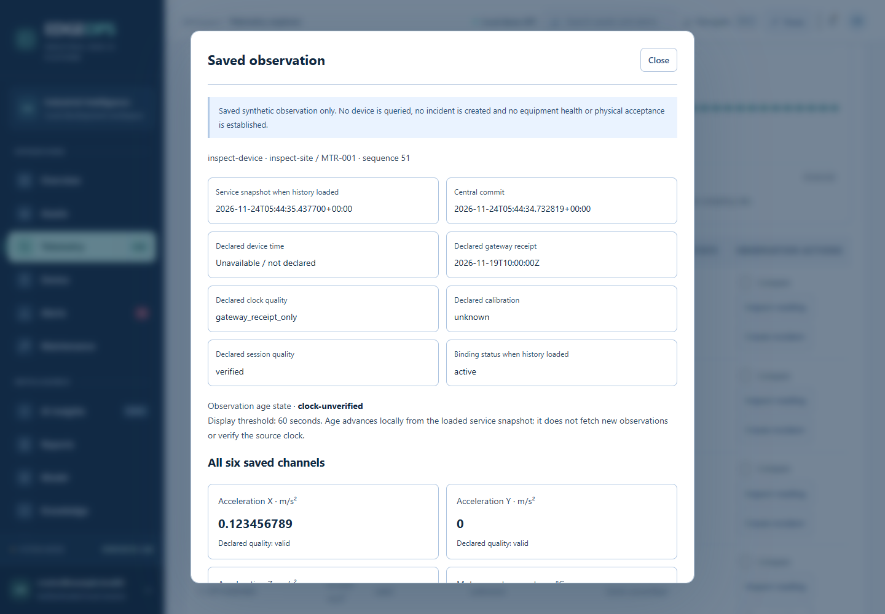
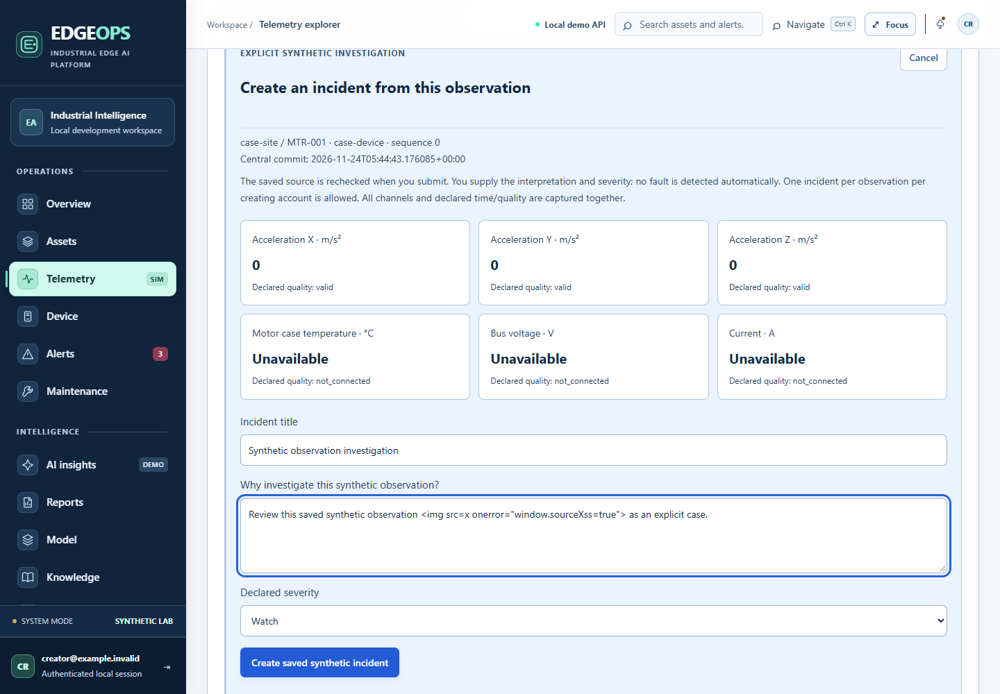
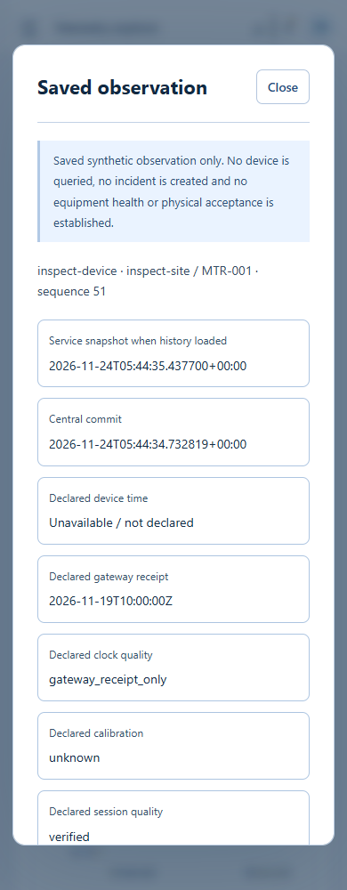

# EDGEOPS — Visual software walkthrough

Captured **24 November 2026** from the existing implementation using disposable synthetic browser-test fixtures. [Evidence register](EVIDENCE.md) · [Capture provenance and hashes](visual-capture-manifest.json)

**These are actual, unedited screenshots of the running local application, not design mockups or physical measurements.** They show synthetic observations and test accounts. No real devices were connected and no equipment action was authorized.

## 30-second software demonstration

[Download the silent WebM preview](assets/EDGEOPS-software-demo.webm) · [Recording provenance and checksums](video-capture-manifest.json)

The recording shows actual application interaction with a disposable synthetic account and database:

1. Inspect a saved observation with zero/unavailable readings and explicit clock/calibration limitations.
2. Prepare and save an explicit synthetic incident.
3. Save a linked maintenance draft and view its retained incident reference.

The capture checks verified that the saved request remained `draft`, execution stayed disabled and its captured observation hash matched the source. Sign-in happened before recording, and browser credentials/session state were not exported. The disposable service and database were removed after the run. No running user dashboard or equipment was used.

Recorded source: **`27d8296e0d15997d61b9bb8fd9bc136f996c2808`**, on 24 November 2026. This video uses a different scripted fixture from the earlier screenshots and API walkthrough; it is not a full test-suite recording.

The downloadable copy is a compressed **1440 x 1000, 2 fps** preview, with the same scene order and roughly 30-second timing. Frame sampling rounds the original 29.8 seconds to 30 seconds. It is a lossy re-encoding; full-size screenshots below are better for inspecting fine text. The original recording's hash is retained in the manifest alongside the published preview's hash. All displayed sensor values and identities are synthetic; no physical acceptance or model performance is established.

## 1. Inspect a saved synthetic observation



The inspector distinguishes the central commit from the declared gateway receipt and unavailable device UTC. It preserves the clock-unverified label and declared calibration status. The desktop screenshot shows the top of a scrollable dialog; it does not show every field at once. A synthetic session declaration labelled `verified` does not verify a physical device.

The [observation-inspector browser suite](https://github.com/shah-hussain-bangash/AI-Edge-Semiconductor-Career-Projects./blob/9f8831f257c490a0b8febf701628bae2ecc63c2d/projects/industrial-edge-ai-predictive-maintenance/dashboard/tests/browser_observation_inspector.cjs) also checks full-precision readings, zero/null/negative values, units, exact loaded-record export, query changes, keyboard close/focus and absence of additional domain writes during inspection.

## 2. Prepare an explicit investigation



The form shows valid zero acceleration separately from unavailable channels. A person supplies an interpretation and severity; the application does not automatically detect a fault from this sample.

**This screenshot shows preparation before submission.** The text field intentionally contains an HTML-like security-test string. It is a test fixture used to verify escaping and non-execution, not a real incident or injected script running in the application. The [observation-incident browser suite](https://github.com/shah-hussain-bangash/AI-Edge-Semiconductor-Career-Projects./blob/9f8831f257c490a0b8febf701628bae2ecc63c2d/projects/industrial-edge-ai-predictive-maintenance/dashboard/tests/browser_observation_incidents.cjs) subsequently verifies the saved case, exact retry, reload/export and permission boundaries.

For the separate one-observation API example with a persisted maintenance draft, use the [saved evidence register](EVIDENCE.md#demonstrated-software-path). The browser screenshots use different fixtures and are not photos of that API run.

## 3. Review the mobile layout



The mobile capture shows the top of the same scrollable inspection dialog. Both browser suites passed checks at **1440, 1024, 768, 390 and 320 pixels** wide, including their configured contrast, overflow, focus and workflow assertions. This supports those tested views; it is not a complete accessibility certification or a claim that every dashboard screen was checked in this capture session.

## Reproduce and inspect the evidence

Both existing suites were rerun successfully on 24 November 2026:

```text
node tests/browser_observation_inspector.cjs
node tests/browser_observation_incidents.cjs
```

Run from the dashboard directory with the existing Python dependencies, Playwright and a compatible Chromium installation configured. The scripts start isolated local services with disposable test databases and generated credentials, exercise synthetic inputs, save screenshots and stop their test services. They do not use the running user dashboard or hardware.

The application tree was `190dd2bc4a804785d5fb340f498ac51a1ed56c7c`, identical to the reviewed GitHub commit `9f8831f257c490a0b8febf701628bae2ecc63c2d`. Source/test links are pinned to that commit. Captures contain dynamic test timestamps, so a fresh run will produce different image hashes.

The [manifest](visual-capture-manifest.json) records image sizes, SHA-256 digests and source/test provenance. Screenshots were visually reviewed for test-only identities and synthetic labels. They supplement source and test results; they do not prove receipt, calibration, hardware operation, model accuracy or production readiness.
